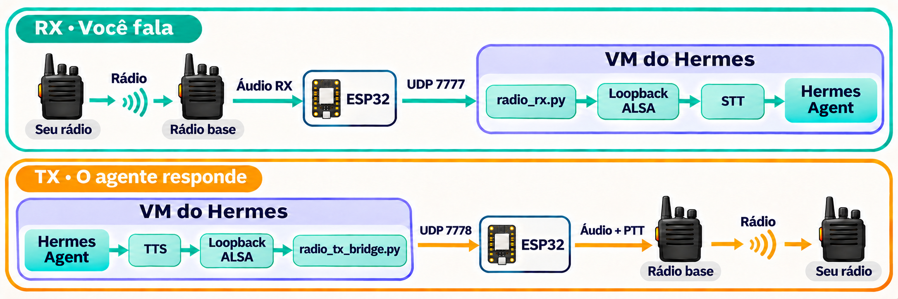
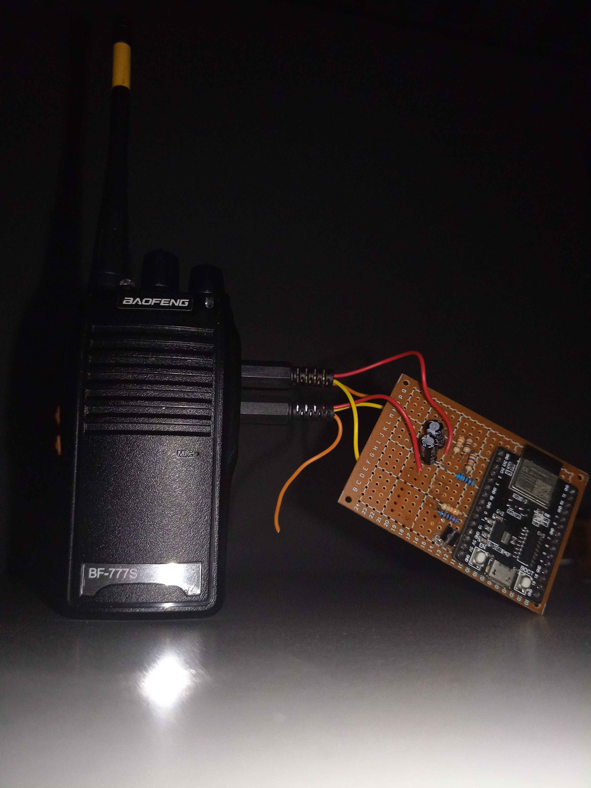
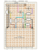

[Português (Brasil)](README.md) · **English**

# Hermes Agent Radio

A voice bridge between Baofeng radios, ESP32, and Hermes Agent.

Talk to an AI agent over a cheap handheld radio. You key up on any radio
on the channel and talk. A Baofeng at the base station receives you, an
ESP32 streams the audio over Wi-Fi to [Hermes Agent](https://github.com/NousResearch/hermes-agent),
and Hermes transcribes it, thinks, and answers through
the Baofeng's microphone input. The radio's PTT is keyed by a transistor.

Credit to Baofeng: affordable, programmable radios with a professional finish
and batteries that last.
A four-pack of BF-777S radios was listed at around R$180
(in November 2026). Keep one at the base and rotate the others: when a
battery runs out, grab another radio and leave that one charging.



This repo is a **self-contained build guide**: parts list, wiring, firmware,
host audio plumbing, the Hermes patches that turn its voice mode into a
radio operator, and the changes that keep the LLM bill small. It does not
include any particular "skills" for the agent. [Adding your own tools](docs/en/12-adding-your-own-tools.md)
shows the pattern with a toy MCP server.

> **⚠ Radio is not private. Read [security and privacy](docs/en/security-and-privacy.md) first.**
> Analogue FM is unencrypted: anyone in range hears both you and the agent,
> and anyone with a radio can talk to it, because a CTCSS tone is not a
> password. Don't use the radio's factory channels, never let the agent speak
> personal data or codes, and keep its tools **read-only** or rate-limited
> for anything risky.
>
> **Licensing.** Transmitting needs whatever licence or type approval your
> country requires for that band and that radio. The scanner features are
> receive-only. You are responsible for what goes on the air.

For Brazil, see [FRS-style channels and separate RX/TX](docs/en/security-and-privacy.md#brazilian-frs-style-channels): choosing a pair without a conventional offset, privacy limits, and Anatel requirements.

## What you need

- A Baofeng with the 2-pin Kenwood (K1) jack. We used a **BF-777S** (BF-888
  programming protocol). Most UV-5R/BF-888 class radios share the pinout.
- Any **Wi-Fi microcontroller** that meets [these requirements](docs/en/02-choosing-a-board.md).
  We used what we had: an ESP32-C3-MINI-1, and before that an ESP32 DevKitC.
  **The wiring and components are what matter.**
- About ten passive parts and one NPN transistor ([bill of materials](docs/en/01-materials.md)).
- A Linux machine or VM running Hermes Agent with network access to the ESP32.
  The physical PC does not need Linux; ALSA audio runs on the Linux machine or VM.

| [Actual build](docs/assets/montagem-baofeng-esp32.jpg) | [C3 board · component side](docs/assets/infographics/radio-c3-componentes.svg) |
|---|---|
|  |  |

## The guide

| # | Chapter | You get |
|---|---|---|
| 0 | [**Security and privacy**](docs/en/security-and-privacy.md) | What the radio can't protect; channel choice, data rules, read-only/rate-limited tools |
| 1 | [Materials](docs/en/01-materials.md) | Parts, tools, what each part does |
| 2 | [Choosing a board](docs/en/02-choosing-a-board.md) | Requirements, our two boards, pin map |
| 3 | [Wiring](docs/en/03-wiring.md) | K-plug pinout, RX, TX, PTT and programming circuits |
| 4 | [Firmware](docs/en/04-firmware.md) | Build/flash, serial diagnostics, UDP protocols, fail-safes |
| 5 | [Host audio](docs/en/05-host-audio.md) | Relay, ALSA loopback, RX/TX bridges, services |
| 6 | [Hermes integration](docs/en/06-hermes-integration.md) | The radio patches, in order |
| 7 | [Hermes cost trim](docs/en/07-hermes-cost-trim.md) | Fewer, smaller LLM calls |
| 8 | [STT and TTS](docs/en/08-stt-and-tts.md) | Cloud STT recommended; optional local Whisper in Hermes |
| 9 | [Radio programming (CHIRP)](docs/en/09-chirp-programming.md) | Read the radio's memory through the same ESP32 |
| 10 | [Scanner and dashboard](docs/en/10-scanner-dashboard.md) | Live STT/TTS view, channel-1 scanner, spectrogram |
| 11 | [Usage meter](docs/en/11-usage-meter.md) | LLM/STT/TTS usage per day |
| 12 | [Adding your own tools](docs/en/12-adding-your-own-tools.md) | MCP and announcement stubs |
| — | [Troubleshooting](docs/en/troubleshooting.md) | Symptom → fix |

## Quick start (once the hardware is built)

```bash
# 1. Firmware
cp firmware/BaofengRx/secrets.example.h firmware/BaofengRx/secrets.h   # Wi-Fi + host IP
python3 tools/flash.py --target c3 --port /dev/ttyUSB0 --monitor             # or omit --target for classic ESP32

# 2. Hear the radio on the PC (no Hermes yet)
python3 -m baofeng_bridge.audio.bridge

# 3. Hermes VM: audio plumbing + patches (see chapters 5–7)
python3 radio_bridge/install.py
for p in base gate input_filter speech announce context; do
  python3 hermes_patches/apply_radio_$p.py ~/.hermes/hermes-agent
done
<hermes-venv>/bin/python hermes_patches/apply_radio_config.py   # Hermes' own Python (has ruamel.yaml)
systemctl --user enable --now baofeng-rx baofeng-tx hermes-radio
```

## Repository map

```text
firmware/                classic ESP32 and ESP32-C3 firmware, each with its own PlatformIO project
baofeng_bridge/audio/    local listening, transmission, UDP relay and VM audio bridges
baofeng_bridge/scanner/  scanner, radio programming and audio recording
baofeng_bridge/web/      dashboard and browser audio JavaScript
baofeng_bridge/stt/      optional local faster-whisper STT
tools/                   firmware flashing and CHIRP backup
radio_bridge/            helpers installed into Hermes; usage meter; installer
hermes_patches/          idempotent Hermes Agent patches and configuration trim
tests/unit/              unit tests for the scanner, helpers, patches and examples
tests/integration/       UDP, HTTP, audio proxy and Hermes integration tests
tests/docs/              documentation validation
examples/                sample MCP server and announcement producer
systemd/                 user units and an environment-file template
```

## Tests

```bash
python3 -m unittest discover -s tests
```

Set `HERMES_AGENT_SRC` to an **unpatched** Hermes Agent checkout to also run
the patch-chain tests. Run them after every `hermes update`, before
re-applying the patches. The patches were last verified against Hermes Agent
`main` at commit `6b21d056` (2026-11-07).

The tests use only the standard library. The scanner itself needs
`pip install -r requirements-scanner.txt` (pyserial, webrtcvad).

## License

This project is distributed under the [MIT license](LICENSE). Dependencies
and third-party code retain their respective licenses.
