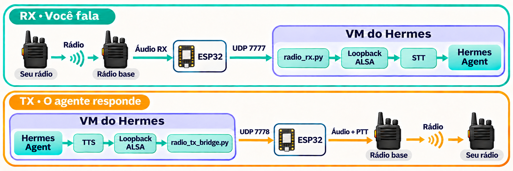
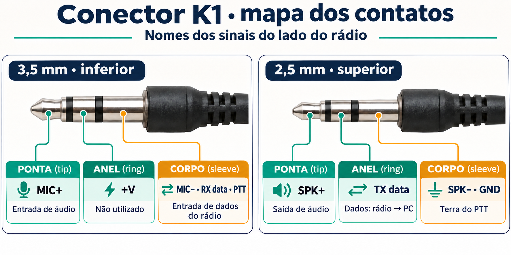
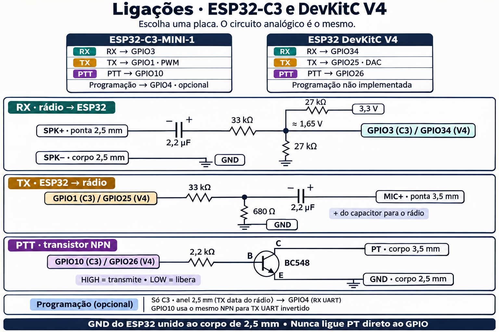
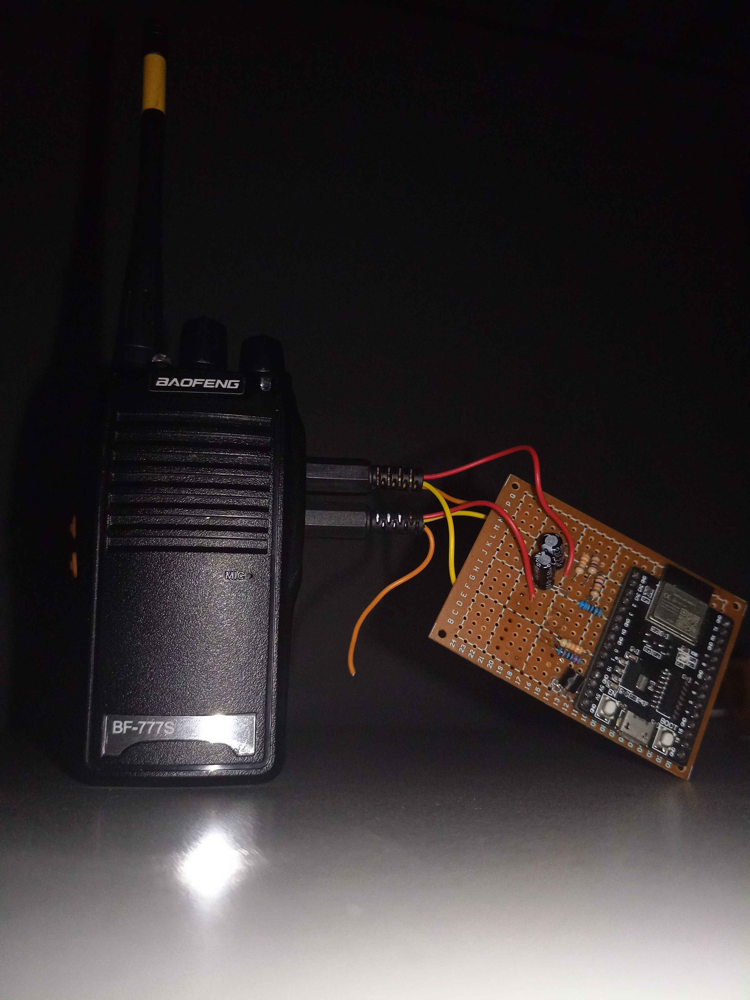
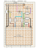

**Português (Brasil)** · [English](README.en.md)

# Hermes Agent Radio

**Baofeng AI**: converse com o Hermes Agent por rádios UHF Baofeng,
com uma ponte ESP32, reconhecimento de voz (STT / speech-to-text),
síntese de voz (TTS / text-to-speech) e ferramentas MCP.

Converse com um agente de IA por um rádio portátil barato. Você aperta o PTT
de qualquer rádio do canal e fala. Um Baofeng na base recebe, um ESP32
envia o áudio por Wi-Fi para o [Hermes Agent](https://github.com/NousResearch/hermes-agent),
e o Hermes transcreve, pensa e responde pela entrada de
microfone do Baofeng. O PTT do rádio é acionado por um transistor.

Ponto pra Baofeng: rádio barato, programável, com acabamento profissional
e bateria que dura bastante.
Um kit com quatro BF-777S saiu anunciado por cerca de R$ 180
(em novembro de 2026). Dá pra deixar um na base e revezar os outros: se
acabar a bateria, pega outro e deixa aquele carregando.



Este repositório é um **guia de montagem completo**: lista de peças,
ligações, firmware, encanamento de áudio no PC, os patches que transformam
o modo de voz do Hermes em um operador de rádio, e os ajustes que mantêm a
conta da LLM pequena. Ele não inclui "habilidades" específicas para o
agente. [Adicionando suas próprias ferramentas](docs/12-adding-your-own-tools.md)
mostra o padrão com um servidor MCP de brinquedo.

> **⚠ Rádio não é privado. Leia [segurança e privacidade](docs/security-and-privacy.md) primeiro.**
> FM analógico não tem criptografia: qualquer pessoa no alcance ouve você e
> o agente, e qualquer pessoa com um rádio pode falar com ele, porque um tom
> CTCSS não é senha. Não use os canais de fábrica do rádio, nunca deixe o
> agente falar dados pessoais ou códigos, e mantenha as ferramentas
> **somente leitura** ou com limite de uso para qualquer coisa arriscada.
>
> **Licenciamento.** Transmitir exige a licença ou homologação que seu país
> pede para aquela faixa e aquele rádio. As funções de scanner são só de
> recepção. Você é responsável pelo que vai ao ar.

Para o Brasil, veja os [canais do tipo FRS e RX/TX separados](docs/security-and-privacy.md#canais-brasileiros-do-tipo-frs): escolha do par sem offset convencional, limites de privacidade e requisitos da Anatel.

## O que você precisa

- Um Baofeng com o conector Kenwood de 2 pinos (K1). Usamos um **BF-777S**
  (protocolo de programação do BF-888). A maioria dos rádios da classe
  UV-5R/BF-888 tem a mesma pinagem.
- Qualquer **microcontrolador com Wi-Fi** que atenda [estes requisitos](docs/02-choosing-a-board.md).
  Usamos o que tínhamos: um ESP32-C3-MINI-1 e, antes dele, um ESP32 DevKitC.
  **O que importa são as ligações e os componentes.**
- Uns dez componentes passivos e um transistor NPN ([lista de materiais](docs/01-materials.md)).
- Uma máquina ou VM Linux com o Hermes Agent e acesso de rede ao ESP32.
  O PC físico não precisa rodar Linux; o áudio ALSA roda na máquina ou VM Linux.





Veja a [pinagem do conector e os detalhes das ligações](docs/03-wiring.md).

| [Montagem real](docs/assets/montagem-baofeng-esp32.jpg) | [Placa C3 · lado dos componentes](docs/assets/infographics/radio-c3-componentes.svg) |
|---|---|
|  |  |

## O guia

| # | Capítulo | O que você ganha |
|---|---|---|
| 0 | [**Segurança e privacidade**](docs/security-and-privacy.md) | O que o rádio não protege; escolha de canal, regras de dados, ferramentas somente leitura ou com limite |
| 1 | [Materiais](docs/01-materials.md) | Peças, ferramentas, a função de cada peça |
| 2 | [Escolhendo a placa](docs/02-choosing-a-board.md) | Requisitos, nossas duas placas, mapa de pinos |
| 3 | [Ligações](docs/03-wiring.md) | Pinagem do K1, circuitos de RX, TX, PTT e programação |
| 4 | [Firmware](docs/04-firmware.md) | Compilar/gravar, diagnóstico serial, protocolos UDP, proteções |
| 5 | [Áudio no host](docs/05-host-audio.md) | Relay, loopback ALSA, pontes de RX/TX, serviços |
| 6 | [Integração com o Hermes](docs/06-hermes-integration.md) | Os patches de rádio, em ordem |
| 7 | [Custo do Hermes](docs/07-hermes-cost-trim.md) | Menos chamadas à LLM, e menores |
| 8 | [STT e TTS](docs/08-stt-and-tts.md) | STT em nuvem recomendado; Whisper local opcional no Hermes |
| 9 | [Programação do rádio (CHIRP)](docs/09-chirp-programming.md) | Ler a memória do rádio pelo mesmo ESP32 |
| 10 | [Scanner e painel](docs/10-scanner-dashboard.md) | STT/TTS ao vivo, scanner no canal 1, espectrograma |
| 11 | [Medidor de uso](docs/11-usage-meter.md) | Uso de LLM/STT/TTS por dia |
| 12 | [Adicionando suas próprias ferramentas](docs/12-adding-your-own-tools.md) | Exemplos de MCP e de avisos |
| — | [Solução de problemas](docs/troubleshooting.md) | Sintoma → correção |

## Início rápido (com o hardware montado)

```bash
# 1. Firmware
cp firmware/BaofengRx/secrets.example.h firmware/BaofengRx/secrets.h   # Wi-Fi + IP do host
python3 tools/flash.py --target c3 --port /dev/ttyUSB0 --monitor             # ou sem --target para o ESP32 clássico

# 2. Ouvir o rádio no PC (ainda sem Hermes)
python3 -m baofeng_bridge.audio.bridge

# 3. VM do Hermes: áudio + patches (capítulos 5–7)
python3 radio_bridge/install.py
for p in base gate input_filter speech announce context; do
  python3 hermes_patches/apply_radio_$p.py ~/.hermes/hermes-agent
done
<hermes-venv>/bin/python hermes_patches/apply_radio_config.py   # o Python do próprio Hermes (tem ruamel.yaml)
systemctl --user enable --now baofeng-rx baofeng-tx hermes-radio
```

## Mapa do repositório

```text
firmware/                firmwares ESP32 clássico e ESP32-C3, com projetos PlatformIO próprios
baofeng_bridge/audio/    recepção local, transmissão, relay UDP e pontes de áudio da VM
baofeng_bridge/scanner/  scanner, programação do rádio e gravação de áudio
baofeng_bridge/web/      dashboard e JavaScript do áudio no navegador
baofeng_bridge/stt/      STT local opcional com faster-whisper
tools/                   gravação do firmware e backup CHIRP
radio_bridge/            auxiliares instalados no Hermes; medidor de uso; instalador
hermes_patches/          patches idempotentes para o Hermes Agent e ajustes de configuração
tests/unit/              testes unitários do scanner, auxiliares, patches e exemplos
tests/integration/       testes de UDP, HTTP, proxy de áudio e integração com o Hermes
tests/docs/              validação da documentação
examples/                servidor MCP de exemplo e gerador de avisos
systemd/                 units de usuário e modelo de arquivo de ambiente
```

## Testes

```bash
python3 -m unittest discover -s tests
```

Defina `HERMES_AGENT_SRC` apontando para um checkout **sem patches** do
Hermes Agent para rodar também os testes da cadeia de patches. Rode-os
depois de cada `hermes update`, antes de reaplicar os patches. Os patches
foram verificados pela última vez contra o `main` do Hermes Agent no
commit `6b21d056` (2026-11-07).

Os testes usam só a biblioteca padrão. O scanner em si precisa de
`pip install -r requirements-scanner.txt` (pyserial, webrtcvad).

## Licença

Este projeto é distribuído sob a [licença MIT](LICENSE). Dependências e
código de terceiros mantêm suas respectivas licenças.
