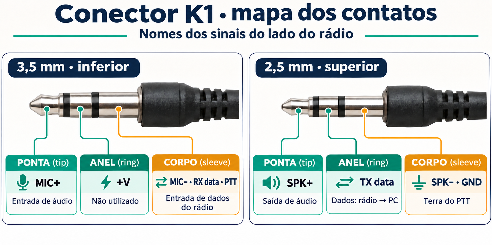
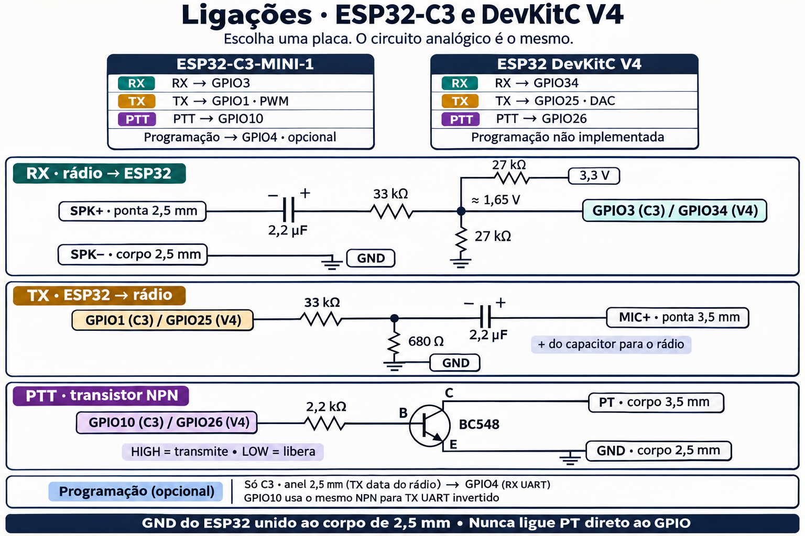
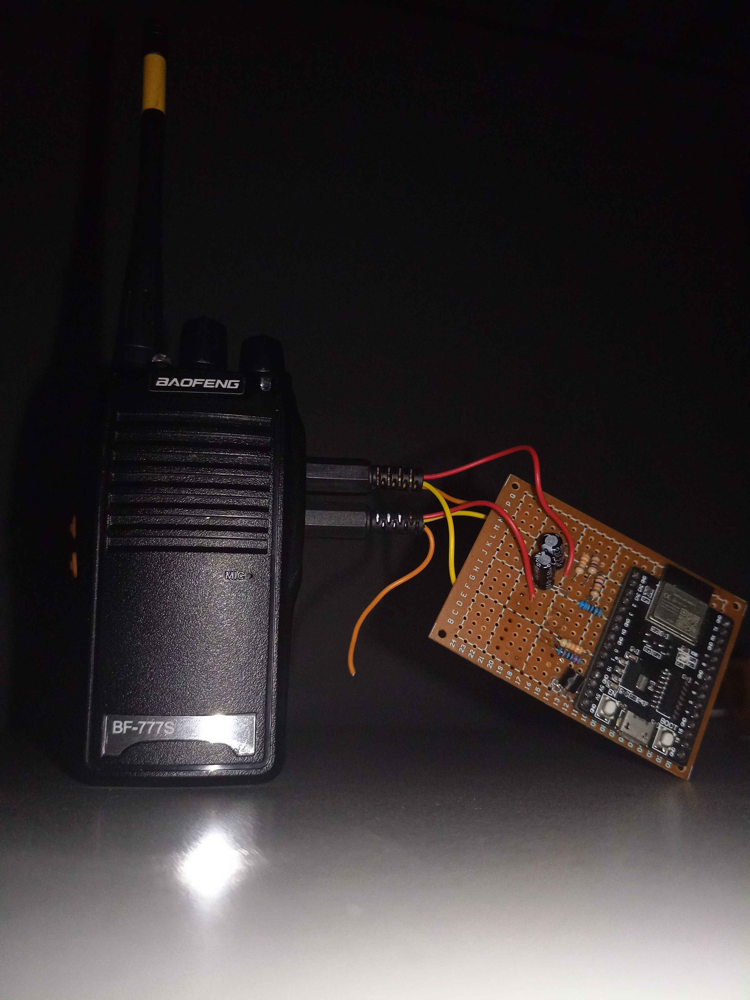
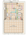

**Português (Brasil)** · [English](en/03-wiring.md)

# 3. Ligações

Quatro circuitos pequenos dividem o mesmo terra: entrada de áudio de RX,
saída de áudio de TX, PTT e (opcionalmente) dados de programação. Os nomes
de pino abaixo são da montagem com ESP32-C3, com o pino do ESP32 clássico
entre colchetes. Veja o [capítulo 2](02-choosing-a-board.md).

> **Terra primeiro.** O − do alto-falante / terra de dados do rádio (corpo
> do plugue de 2,5 mm) e o GND do ESP32 são unidos. Todo o resto usa esse
> nó como referência.

## O plugue K1 (Kenwood de 2 pinos)

Olhando para o plugue, com os nomes de pino do lado do rádio. Headsets
baratos costumam deixar sem ligação os dois condutores de "dados / +V".



(tip = ponta, ring = anel, sleeve = corpo.)

- Ligar o **corpo do 3,5 mm** (PT) ao **corpo do 2,5 mm** (GND) aciona o
  rádio. O mesmo contato é a entrada de dados de programação do rádio.
- O **anel do 2,5 mm** é a saída de dados de programação do rádio.

Confira no seu rádio com um multímetro antes de ligar qualquer coisa. Uma
referência bem usada é a pinagem do conector K no [Miklor.com](https://www.miklor.com/).

## RX: alto-falante → ADC



- O divisor 27k/27k polariza o nó do ADC em **~1,65 V**. Meça com o ESP32
  ligado e o rádio desligado.
- O capacitor bloqueia o DC do rádio, e o 33k define o nível. **Se o RX
  saturar ou ficar baixo demais, troque o 33k**: menor fica mais alto,
  maior fica mais baixo. Não mexa no par de 27k.
- O botão de volume do rádio também define o nível. Marque uma posição que
  dê `clipping=none` nas estatísticas seriais ([capítulo 4](04-firmware.md))
  e deixe lá.

## TX: PWM/DAC → microfone

- O par 33k/680R atenua a saída em escala cheia para uns **67 mVpp** no
  M+, que é nível de microfone.
- **Polaridade do capacitor: + para o lado do rádio.** A entrada de
  microfone fica numa polarização DC positiva.
- O firmware mantém a forma de onda centrada no meio da escala (DAC 128 /
  duty do PWM 128) e nunca passa da escala cheia de 8 bits. Subir a
  constante de amplitude acima de 128 só satura.

## PTT: GPIO → NPN → PT

- GPIO em **HIGH** = transistor conduzindo = PT no terra = transmitindo. LOW libera.
- **Nunca ligue o PT direto num GPIO.**
- A pinagem do BC548 varia com o encapsulamento e o fabricante. Confira a
  sua (C-B-E é comum em BC5xx TO-92, mas não é universal).

## Dados de programação (opcional, ESP32-C3)

```text
 2.5 mm ring (radio TX data) ───────────► GPIO4   (UART1 RX, 3.3 V levels)
 GPIO10 → 2.2k → BC548 → PT  (already wired above: doubles as UART1 TX, inverted in firmware)
```

Não precisa de fio extra para a entrada de dados do rádio: o transistor do
PTT já aciona esse contato. O firmware inverte o TX da UART para que a
inversão do próprio transistor se cancele, e em repouso o PTT fica
liberado. Veja o [capítulo 9](09-chirp-programming.md).

## Montagem em placa perfurada

Baofeng BF-777S ligado ao ESP32 e aos circuitos de RX, TX e PTT em placa perfurada.

| [Montagem real](assets/montagem-baofeng-esp32.jpg) | [Placa C3 · lado dos componentes](assets/infographics/radio-c3-componentes.svg) |
|---|---|
|  |  |

O SVG usa uma variante de valores: RX de 20 kΩ, polarização de
10 kΩ/10 kΩ e atenuador de TX de 33 kΩ/690 Ω.

## Nossa protoboard (para referência)

Uma protoboard de 30 linhas (colunas A–J, sem trilhas de alimentação),
primeira montagem (ESP32 clássico):

```text
Radio S+  → A30          Radio S− → A29        jumper B29 → C21 (radio ground → GND row)
2.2µF RX: − B30, + B27   33k: C27 → C24        ADC pin → D24
27k #1: E24 → E20        27k #2: B24 → B21
ESP32 3.3V → A20         ESP32 GND → A21

Rows: 20 = 3.3V · 21 = GND · 24 = ADC node · 27 = cap out / 33k in · 29 = S− · 30 = S+
```

O 2,2 µF do RX tem o **−** para o lado do rádio e o **+** para o lado do
ADC polarizado em 1,65 V, como no diagrama acima. Num eletrolítico, o + vai
para o lado que estiver na tensão DC mais alta. Se o seu rádio for
diferente, meça os dois lados.
