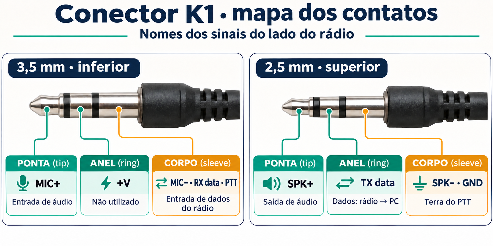
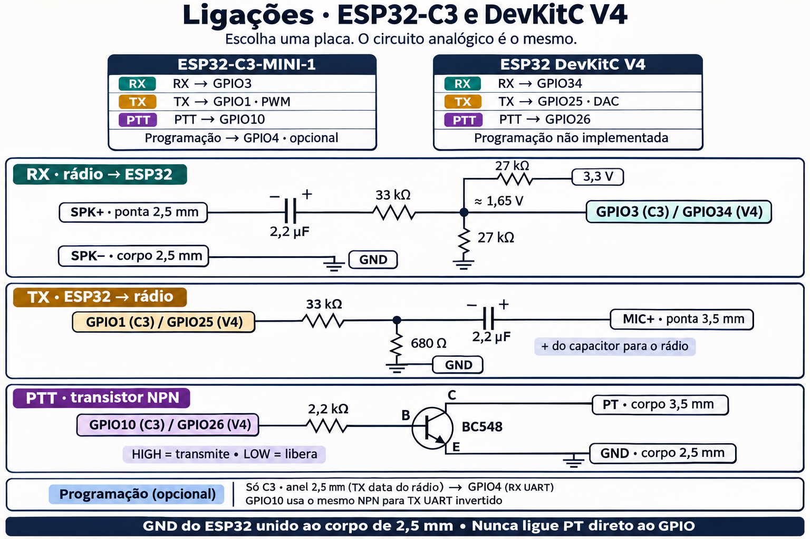
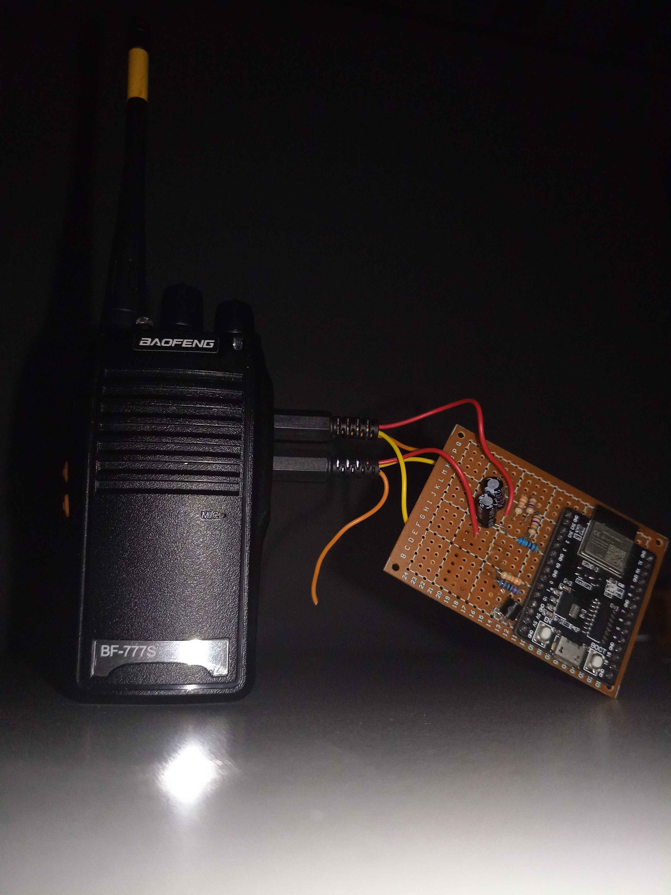
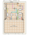

[Português (Brasil)](../03-wiring.md) · **English**

# 3. Wiring

Four small circuits share one ground: RX audio in, TX audio out, PTT, and
(optionally) programming data. Pin names below are for the ESP32-C3 build,
with the classic ESP32 pin in brackets. See [chapter 2](02-choosing-a-board.md).

> **Ground first.** The radio's speaker − / data ground (2.5 mm sleeve) and the
> ESP32 GND are joined. Everything else references that node.

## The K1 (Kenwood 2-pin) plug

Looking at the plug, radio-side pin names. Cheap headsets usually leave the
two "data / +V" conductors unconnected.



- Pulling **3.5 mm sleeve** (PT) to **2.5 mm sleeve** (GND) keys the radio.
  The same contact is the radio's programming-data input.
- **2.5 mm ring** is the radio's programming-data output.

Verify on your own radio with a meter before connecting anything. A widely
used reference is the K-plug pinout on [Miklor.com](https://www.miklor.com/).

## RX: speaker → ADC



- The 27k/27k divider biases the ADC node at **~1.65 V**. Measure it with the
  ESP32 powered and the radio off.
- The capacitor blocks the radio's DC, and the 33k sets the level. **If RX
  clips or is too quiet, change the 33k**: smaller is louder, larger is
  quieter. Leave the 27k pair alone.
- The radio's volume knob also sets the level. Mark a position that gives
  `clipping=none` in the serial stats ([chapter 4](04-firmware.md)) and leave
  it there.

## TX: PWM/DAC → microphone

- The 33k/680R pair attenuates a full-scale output to roughly **67 mVpp**
  at M+, which is microphone level.
- **Capacitor polarity: + towards the radio.** The mic input sits at a
  positive DC bias.
- The firmware keeps the waveform centred on mid-scale (DAC 128 / PWM duty
  128) and never drives more than full 8-bit scale. Raising the amplitude
  constant above 128 only clips.

## PTT: GPIO → NPN → PT

- GPIO **HIGH** = transistor on = PT grounded = transmitting. LOW releases.
- **Never wire PT to a GPIO directly.**
- BC548 pinouts vary by package and maker. Check yours (C-B-E is common for
  TO-92 BC5xx, but not universal).

## Programming data (optional, ESP32-C3)

```text
 2.5 mm ring (radio TX data) ───────────► GPIO4   (UART1 RX, 3.3 V levels)
 GPIO10 → 2.2k → BC548 → PT  (already wired above: doubles as UART1 TX, inverted in firmware)
```

No extra wire is needed for the radio's data input: the PTT transistor
already drives that contact. The firmware inverts UART TX so the
transistor's own inversion cancels out, and idle leaves PTT released. See
[chapter 9](09-chirp-programming.md).

## Perfboard build

Baofeng BF-777S connected to the ESP32 and RX, TX and PTT circuits on perfboard.

| [Actual build](../assets/montagem-baofeng-esp32.jpg) | [C3 board · component side](../assets/infographics/radio-c3-componentes.svg) |
|---|---|
|  |  |

The SVG uses an alternative set of values: 20 kΩ for RX, a 10 kΩ/10 kΩ
bias divider and a 33 kΩ/690 Ω TX attenuator.

## Our breadboard layout (for reference)

A 30-row breadboard (columns A–J, no power rails), first build (classic ESP32):

```text
Radio S+  → A30          Radio S− → A29        jumper B29 → C21 (radio ground → GND row)
2.2µF RX: − B30, + B27   33k: C27 → C24        ADC pin → D24
27k #1: E24 → E20        27k #2: B24 → B21
ESP32 3.3V → A20         ESP32 GND → A21

Rows: 20 = 3.3V · 21 = GND · 24 = ADC node · 27 = cap out / 33k in · 29 = S− · 30 = S+
```

The RX 2.2 µF has **−** toward the radio and **+** toward the biased
1.65 V ADC side, as in the diagram above. For an electrolytic, + goes to
whichever side sits at the higher DC voltage. If your radio differs,
measure both sides.
